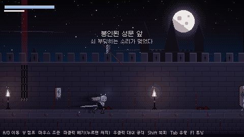
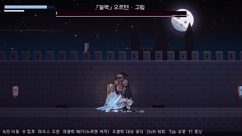
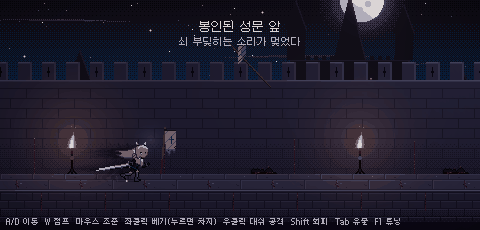

# 일곱 서약 (Seven Oaths)

> 마교에 침식된 성국에서, **수정검을 든 은발의 기사**가 타락한 전설의 7기사를 차례로 쓰러뜨리는
> 2D 도트 횡스크롤 액션. **무겁게 때리고, 회피로 끊고, 받아내고, 다시 때린다.**

*패리에 성공하면 시간이 멈춘다. 뒤로 미끄러지며 칼을 짚고 버티다가 — 좌클릭 — 빛이 되어 돌진, 구체 안에 참격 9줄을 꽂고 '쾅'.*

현재 단계: **버티컬 슬라이스** — 수련장 · 1지역 「잿빛 성벽」 · 1번 기사 「철벽」 · 서약 유물/패리

| 첫 대면 — 함성과 붉은 이름 | 처치 — 서약이 검에 스며든다 |
|---|---|
|  |  |
| **방패 돌진 — 차징 → 붉은 줄 → 돌진** | **서약 유물 장착 (Tab)** |
|  |  |

---

## 손맛

- **베기 3연 · 차지(2단) · 빛의 검 대쉬(360° 조준)** — 대쉬로 적을 맞히면 공중 대쉬가 다시 충전된다. 위·아래 사선 대쉬는 전용 동작.
- **자세(포이즈)** — 흰 막대를 다 깎으면 무너진다 → 가까이서 좌클릭 = **처형**.
- **루멘 · 영혼의 수정 · 성수병** — 적을 쓰러뜨리면 빛 알갱이 「루멘」이 빨려 든다. 죽으면 루멘이 그 자리의 **영혼의 수정**에 갇히고, 다시 가서 베어 부수면 되찾는다. 회복은 **성수병**(Q, 3회, 성수 제단에서 채워짐).
- **퍼펙트 회피** — 닿기 직전에 피하면 슬로 + 다음 공격 반격.
- **패리와 반격 오의** — 「철벽의 문장」을 끼면 방향키 없이 Shift = 패리. 성공하면 크로노스피어(시간 정지) 안에서 좌클릭으로 오의.
- **타격감** — 히트스톱 · 화면 흔들림 · 피격 플래시 · 수정 파편 · 블룸 · 패드 진동. F1 패널에서 실시간 튜닝.

## 1지역 「잿빛 성벽」과 1번 기사 「철벽」

- **적 3종**: 검병, **정면이 막히는 방패병**(등 뒤를 베라), **붉은 조준선 석궁병**(화살은 패리로 되받아친다).
- **전투방**: 창살이 내려오고 3웨이브. **성수 제단**: HP 회복 + 부활 지점.
- **「철벽」 오르텐**: 탑실드 + 장검. 정면 방패, 장검 내려베기(땅 충격파), 방패 반격, **3단계로 읽히는 방패 돌진**(벽에 부딪히면 기절),
  HP 50%에서 포효 → 2페이즈(쇠기둥 '고립의 벽', 3연 내려베기, 이중 돌진). 쓰러뜨리면 **서약 유물**을 남긴다.

## 조작

| 행동 | 키보드·마우스 | 게임패드 |
|---|---|---|
| 이동 | A / D | 왼스틱 |
| 점프 | W 또는 Space | A |
| 조준 | 마우스 | 오른스틱 |
| 베기(3연) · 누르고 있으면 차지 | 좌클릭 | X |
| 대쉬 공격(조준 방향) | 우클릭 | RT / RB |
| 회피 | Shift(방향키와 함께) | B |
| 패리(유물 「철벽의 문장」) | 방향키 없이 Shift | B(스틱 중립) |
| 반격 오의(패리 성공 → 시간 정지 중) | 좌클릭 | X |
| 성수병(회복) | Q | LB |
| 서약 유물 장착 창 | Tab | Y |
| 일시정지 메뉴 | ESC | Start |
| 타격감 튜닝 패널 | F1 | Select |

- 보스 전에 패리를 써 보려면 F1 패널 → **패리 유물 받기**.
- 종료: ESC → 저장 후 종료(또는 Alt+F4).

## 다음 계획

1. **버티컬 슬라이스 다듬기** ← 다음
   - 보스 처치·유물을 저장에 기록(다시 실행해도 「철벽」이 쓰러진 채로), 처치 뒤 성문이 열려 "다음 지역" 안내
   - ~~타이틀 화면~~ (완료: SEVEN OATHS 문구, 숨 쉬는 도트 포트레이트, 새 게임 / 이어하기 / 옵션 / 종료) · 1지역 엔딩 컷
   - 직접 플레이 피드백으로 보스 수치·오의 위력·보스 BGM 루프 다듬기
2. **2지역 + 2번 기사 「맹렬」** — 쌍도끼 연타·돌진, 유물 ②「맹렬의 문장」(돌진 베기), 유물 칸 3개 중 고르는 재미 시작
3. **베타 → 릴리스** — 3~4지역 분량, 난이도 곡선, 설정(키 바꾸기), 배포용 빌드

자세한 기획·수치: [`Docs/GDD.md`](Docs/GDD.md)

## 개발

- Unity 6000.3.5f2 (2D URP), Input System + `InputSystemUIInputModule`.
- 전투 규칙: `Assets/Scripts/Model`(순수 C#, 60Hz 고정 틱, EditMode 테스트 54개).
- 문서: `Docs/GDD.md`(기획·수치), `Docs/ASSET_SPEC.md`(아트·사운드 계약), `Docs/ART_LOG.md`, `Docs/SOUND_LOG.md`, `Docs/CREDITS.md`.
- 메뉴 `Seven Oaths/…`: 셋업, 에셋 연결, 빌드. 자동 검증은 `-so*` 명령줄 옵션(`DebugAutomation`) — 서브 모니터·음소거로 실행.
- 도트: Aseprite(`.aseprite` 태그 = 애니메이션), 폰트: Galmuri.

## 크레딧

- 보스 음악: *Dragon Castle* (Boss Battle 30) by **Makai Symphony** — [makai-symphony.com](https://makai-symphony.com/9-2/)
- 그 밖의 음악·효과음·도트·코드: 이 프로젝트에서 제작 — [`Docs/CREDITS.md`](Docs/CREDITS.md)
