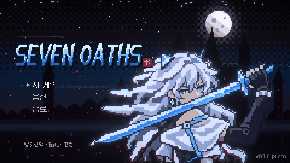
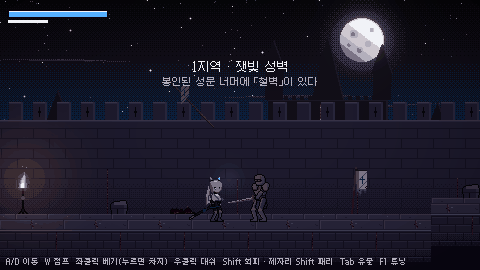
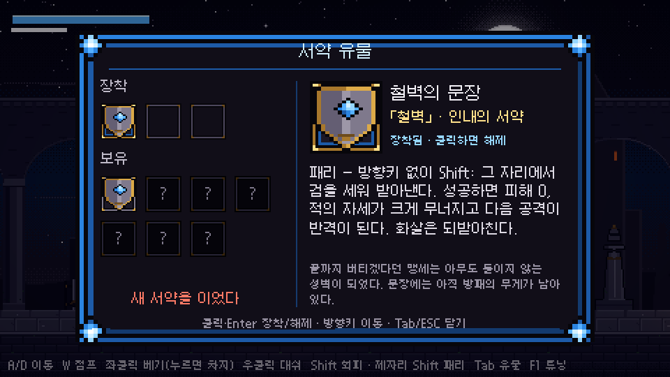

# 일곱 서약 (Seven Oaths)

> 마교에 침식된 성국에서, **수정검을 든 은발의 기사**가 타락한 전설의 7기사를 차례로 쓰러뜨리는
> 2D 도트 횡스크롤 액션. **무겁게 때리고, 회피로 끊고, 받아내고, 다시 때린다.**





*패리에 성공하면 시간이 멈춘다. 뒤로 미끄러지며 칼을 짚고 버티다가 — 좌클릭 — 빛이 되어 돌진, 구체 안에 참격 9줄을 꽂고 '쾅'.*

현재 단계: **버티컬 슬라이스** — 수련장(튜토리얼) · 1-1 「잿빛 성벽」 · 1-2 「무너진 망루」 · 1번 기사 「철벽」 · 서약 유물/패리

> 그림을 **HD(640×360)로 바꾸는 중**입니다. 주인공·배경·효과·UI는 HD가 들어갔고 적·보스는 아직입니다.
> 이 문서의 화면은 전환 전(480×270) 그림입니다. HD로 보려면 [HD 그림](#hd-그림-전환-중) 참고.

| 첫 대면 — 함성과 붉은 이름 | 처치 — 서약이 검에 스며든다 |
|---|---|
|  |  |
| **방패 돌진 — 차징 → 붉은 줄 → 돌진** | **서약 유물 장착 (Tab)** |
|  |  |

---

## 손맛

- **베기 3연 · 차지(2단) · 빛의 검 대쉬(360° 조준)** — 대쉬로 적을 맞히면 공중 대쉬가 다시 충전된다. 위·아래 사선 대쉬는 전용 동작.
- **자세(포이즈)** — 흰 막대를 다 깎으면 무너진다 → 가까이서 좌클릭 = **처형**.
- **루멘 · 영혼의 수정 · 성수병** — 적을 쓰러뜨리면 빛 알갱이 「루멘」이 빨려 든다. 죽으면 루멘이 그 자리의 **영혼의 수정**에 갇히고, 다시 가서 베어 부수면 되찾는다. 회복은 **성수병**(Q, 3회, 성수 제단에서 채워짐).
- **퍼펙트 회피** — 닿기 직전에 피하면 슬로 + 다음 공격 반격.
- **패리와 반격 오의** — 「철벽의 문장」을 끼면 방향키 없이 Shift = 패리. 성공하면 크로노스피어(시간 정지) 안에서 좌클릭으로 오의.
- **납도와 발도** — 걷고 달리고 뛸 때는 칼을 검집에 넣고 다닌다. 공격·회피·대쉬를 하면 뽑고, 싸우는 동안은 칼을 든 채 달린다. 마지막 전투 동작 3초 뒤 근처에 적이 없으면 달리면서 한 번에 넣는다. 가만히 서 있어도 2초 뒤 넣는다.
- **타격감** — 히트스톱 · 화면 흔들림 · 피격 플래시 · 수정 파편 · 블룸 · 패드 진동. F1 패널에서 실시간 튜닝.

## 1지역 「잿빛 성벽」과 1번 기사 「철벽」

진행: 수련장 → 1-1 잿빛 성벽 → 1-2 무너진 망루 → 보스 「철벽」.

- **수련장 튜토리얼**: 이동 → 점프 → 베기 → 차지 → 대쉬 → 회피 → 처형 → 실전 → 성수병 순서로, 직접 해 보면 다음으로 넘어간다. 아무것도 막지 않아서 그냥 출구로 나가도 된다.
- **적 4종**: 검병, **정면이 막히는 방패병**(등 뒤를 베라), **붉은 조준선 석궁병**(화살은 패리로 되받아친다), **침식 사냥개**(체력은 낮지만 빠르고, 2~3마리가 무리로 달려든다).
- **1-2 무너진 망루**: 위로 올라가는 세로 스테이지. 밟으면 흔들리다 부서지는 **무너지는 발판**과 위층에서 쏘는 석궁병.
- **전투방**: 창살이 내려오고 3웨이브. **성수 제단**: HP 회복 + 부활 지점.
- **「철벽」 오르텐**: 탑실드 + 장검. 정면 방패, 장검 내려베기(땅 충격파), 방패 반격, **3단계로 읽히는 방패 돌진**(벽에 부딪히면 기절),
  HP 50%에서 포효 → 2페이즈(쇠기둥 '고립의 벽', 3연 내려베기, 이중 돌진). 쓰러뜨리면 **서약 유물**을 남긴다.

## 조작

| 행동 | 키보드·마우스 | 게임패드 |
|---|---|---|
| 이동 | A / D | 왼스틱 |
| 점프 | W 또는 Space | A |
| 조준 | 마우스 | 오른스틱 |
| 베기(3연) · 누르고 있으면 차지 | 좌클릭 | X |
| 대쉬 공격(조준 방향) | 우클릭 | RT / RB |
| 회피 | Shift(방향키와 함께) | B |
| 패리(유물 「철벽의 문장」) | 방향키 없이 Shift | B(스틱 중립) |
| 반격 오의(패리 성공 → 시간 정지 중) | 좌클릭 | X |
| 성수병(회복) | Q | LB |
| 서약 유물 장착 창 | Tab | Y |
| 일시정지 메뉴 | ESC | Start |
| 타격감 튜닝 패널 | F1 | Select |
| 소품 배치 도구(개발용) | F2 | — |

- 보스 전에 패리를 써 보려면 F1 패널 → **패리 유물 받기**.
- 종료: ESC → 저장 후 종료(또는 Alt+F4).

## HD 그림 (전환 중)

게임 규칙(판정·속도·레벨 칸 16px)은 그대로 두고 그림만 1.5배 촘촘하게 바꾸는 중이다(480×270 → 640×360).

- 들어간 것: 주인공(187프레임), 1지역 타일·배경·소품, 효과, UI.
- 아직인 것: 적·보스. 그래서 HD는 기본이 아니라 실행 옵션 `-soHD`로 켠다. HD 그림이 없는 것은 옛 그림으로 나온다.
- 빌드(메뉴 `Seven Oaths/…`)한 뒤 아래처럼 실행한다.

```powershell
& ".\Builds\Win64\SevenOaths.exe" -soHD
```

## 소품 배치 도구 (F2)

게임을 돌리면서 환경 소품을 직접 놓는 개발용 도구. 켜면 게임이 멈춘다.

| 하는 일 | 조작 |
|---|---|
| 소품 고르기 | 목록 클릭 또는 Q / E |
| 놓기 · 옮기기 | 클릭 · 드래그 |
| 1px 옮기기(Shift = 8px) | 방향키 |
| 바닥에 붙이기 | G |
| 복제 · 되돌리기 · 지우기 | Ctrl+D · Ctrl+Z · Del |
| 카메라 | WASD 또는 휠 버튼 드래그 |
| 저장 | Ctrl+S |

저장하면 `Assets/Resources/Levels/<레벨>.txt`의 `@prop` 줄만 바뀌고, 바꾸기 전 파일은 `LevelEdits` 폴더에 백업된다. 저장한 배치는 다시 빌드하지 않아도 다음 실행에 보인다.

## 다음 계획

1. **1지역을 보스까지 4스테이지로** ← 다음
   - ~~1-2 무너진 망루 · 침식 사냥개 · 수련장 튜토리얼~~ (완료)
   - ~~보스 처치·유물을 저장에 기록~~ (완료) · ~~타이틀 화면~~ (완료)
   - 1-3 지하 수로 · 1-4 성문 앞 광장 · 거점 「새벽 성소」 — 배경 그림은 준비됨, 레벨은 아직
   - 소품 배치(F2 도구로 진행 중: 1-1은 1차 배치, 망루·보스방은 비어 있음)
2. **HD 전환 마무리** — 적·보스 HD 그림 → HD를 기본으로
3. **2지역 + 2번 기사 「맹렬」** — 쌍도끼 연타·돌진, 유물 ②「맹렬의 문장」(돌진 베기), 유물 칸 3개 중 고르는 재미 시작
4. **베타 → 릴리스** — 3~4지역 분량, 난이도 곡선, 설정(키 바꾸기), 배포용 빌드

자세한 기획·수치: [`Docs/GDD.md`](Docs/GDD.md)

## 개발

- Unity 6000.3.5f2 (2D URP), Input System + `InputSystemUIInputModule`.
- 전투 규칙: `Assets/Scripts/Model`(순수 C#, 60Hz 고정 틱, EditMode 테스트 85개).
- 문서: `Docs/GDD.md`(기획·수치), `Docs/ASSET_SPEC.md`(아트·사운드 계약), `Docs/ART_LOG.md`, `Docs/SOUND_LOG.md`, `Docs/CREDITS.md`.
- 메뉴 `Seven Oaths/…`: 셋업, 에셋 연결, 빌드. 자동 검증은 `-so*` 명령줄 옵션(`DebugAutomation`) — 서브 모니터·음소거로 실행.
- 레벨: `Assets/Resources/Levels/*.txt`(글자 지도 + `@prop` 같은 지시문). HD 그림: `Assets/Art/HD/`(옛 그림과 같은 경로·이름이면 덮어씀).
- 도트: Aseprite(`.aseprite` 태그 = 애니메이션). 주인공 HD와 새 지역 배경은 PixelLab으로 만든 뒤 손으로 다듬음. 폰트: Galmuri.

## 크레딧

- 보스 음악: *Dragon Castle* (Boss Battle 30) by **Makai Symphony** — [makai-symphony.com](https://makai-symphony.com/9-2/)
- 그 밖의 음악·효과음·도트·코드: 이 프로젝트에서 제작(도트 일부는 PixelLab 생성 후 손보정) — [`Docs/CREDITS.md`](Docs/CREDITS.md)
